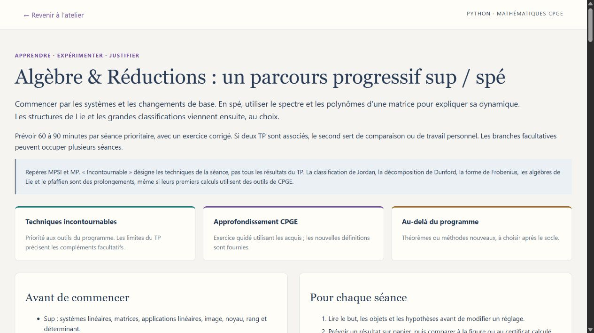

# Parcours progressifs de mathématiques — sup / spé

Les neuf ateliers proposent un parcours avec accès direct aux expériences et retour à la séance. Pour chaque étape : un but, un travail concret, un acquis attendu et les compléments à réserver pour plus tard.

**Techniques incontournables** : outils du programme à maîtriser. **Approfondissements CPGE** : exercices guidés avec les nouveaux éléments fournis. **Au-delà** : théorèmes et méthodes à choisir après le socle. Un TP peut servir à plusieurs paliers, selon la partie étudiée.

| Atelier | Séances prioritaires | Approfondissements | Pistes au-delà | Parcours |
|---|---:|---:|---:|---|
| Rubik & Groupes | 6 | 2 | 2 | [Lire](rubik_groupes/PARCOURS_PROGRESSIF.md) |
| Optimisation & Distances | 6 | 2 | 3 | [Lire](optimisation_distances/PARCOURS_PROGRESSIF.md) |
| Probabilités & Expériences | 6 | 2 | 3 | [Lire](probabilites_cpge/PARCOURS_PROGRESSIF.md) |
| Calcul différentiel & Transformations | 6 | 2 | 3 | [Lire](calcul_differentiel/PARCOURS_PROGRESSIF.md) |
| Algèbre & Réductions | 7 | 2 | 3 | [Lire](algebre_lineaire/PARCOURS_PROGRESSIF.md) |
| Séries & Signaux | 8 | 3 | 3 | [Lire](series_transformees_signal/PARCOURS_PROGRESSIF.md) |
| Topologie & Ensembles | 8 | 3 | 3 | [Lire](topologie_ensembles/PARCOURS_PROGRESSIF.md) |
| Fonctions & Équations | 8 | 3 | 3 | [Lire](analyse_fonctions/PARCOURS_PROGRESSIF.md) |
| Polynômes & Géométrie | 8 | 2 | 4 | [Lire](polynomes/PARCOURS_PROGRESSIF.md) |

Commencer par le parcours du sujet travaillé en cours. Pour les expériences : prévoir le résultat, modifier un réglage, expliquer le changement, puis rédiger la justification. Les références officielles et les limites de programme figurent dans chaque parcours.

Sous Windows, utiliser le lanceur habituel de l’atelier, puis **Parcours sup / spé**. Le document associé reste consultable sans lancer le serveur.
