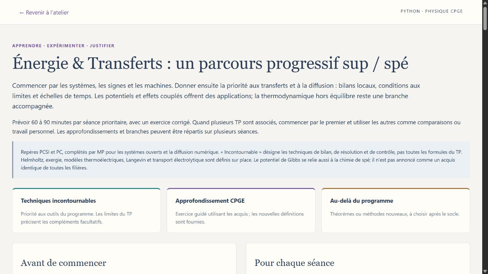

# Parcours progressifs de physique et de chimie — sup / spé

Les dix ateliers proposent un parcours avec accès direct aux TP et retour à la séance. Chaque séance annonce son but, le travail demandé, les acquis à vérifier et les limites du modèle.

**Techniques incontournables** : outils du programme à maîtriser, selon la filière. **Approfondissements CPGE** : problèmes guidés qui réinvestissent ces outils avec les données fournies. **Au-delà du programme** : modèles et méthodes supplémentaires, à choisir après le socle. Une même expérience peut servir à plusieurs paliers ; la consigne précise la partie à étudier.

| Atelier | Séances prioritaires | Approfondissements | Pistes au-delà | TP couverts | Parcours |
|---|---:|---:|---:|---:|---|
| Physique quantique & Qubits | 5 | 2 | 3 | 9 | [Lire](physique_quantique/PARCOURS_PROGRESSIF.md) |
| Physique statistique & Équilibres | 5 | 2 | 3 | 8 | [Lire](physique_statistique/PARCOURS_PROGRESSIF.md) |
| Fluides & Ondes | 7 | 3 | 3 | 18 | [Lire](mecanique_fluides/PARCOURS_PROGRESSIF.md) |
| Champs & Matière | 8 | 4 | 4 | 24 | [Lire](electromagnetisme/PARCOURS_PROGRESSIF.md) |
| Lumière & Images | 8 | 3 | 3 | 24 | [Lire](optique/PARCOURS_PROGRESSIF.md) |
| Mécanique & Mouvements | 8 | 3 | 3 | 24 | [Lire](mecanique_classique/PARCOURS_PROGRESSIF.md) |
| Énergie & Transferts | 8 | 4 | 3 | 30 | [Lire](thermodynamique/PARCOURS_PROGRESSIF.md) |
| Électricité & Technologies | 9 | 4 | 3 | 36 | [Lire](electricite_technologies/PARCOURS_PROGRESSIF.md) |
| Liaisons & Synthèses | 12 | 2 | 4 | 42 | [Lire](chimie_organique/PARCOURS_PROGRESSIF.md) |
| Chimie pour l’industrie | 10 | 2 | 3 | 24 | [Lire](chimie_industrielle/PARCOURS_PROGRESSIF.md) |

Commencer par le sujet travaillé en cours, puis avancer du socle vers les compléments. Sous Windows, utiliser le lanceur habituel et ouvrir **Parcours sup / spé**. Les documents associés restent lisibles sans serveur. Les expériences et leurs réglages restent disponibles indépendamment du parcours.

Méthode commune : définir le système, ses objets et ses unités ; prévoir une variation ; modifier un paramètre ; confronter le résultat à un bilan ou une loi ; rédiger une conclusion courte avec ses hypothèses. Les repères officiels et les différences de programme utiles figurent dans chaque parcours.

[Parcours de mathématiques](PARCOURS_MATHS_CPGE.md) · [Tous les ateliers et leurs lanceurs](README.md) · [Chimie industrielle : errata des formules](chimie_industrielle/errata.md)
