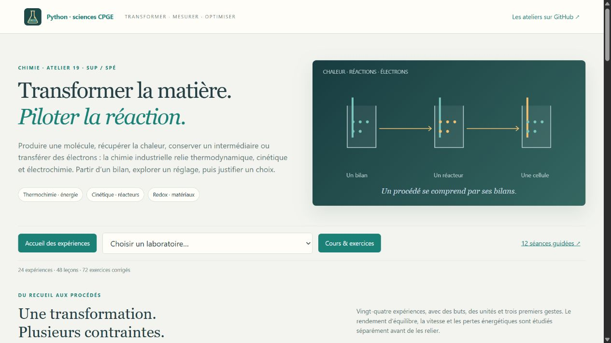

# Chimie pour l’industrie

**24 laboratoires interactifs · 48 leçons · 72 exercices corrigés · 24 figures scientifiques.**

Un atelier de **sup et spé** construit à partir de l’extrait C6–C8 du recueil de A. R., pages **545–570**. Il relie les fiches de cinétique, d’oxydo-réduction et de thermochimie à des applications industrielles, techniques et de recherche.



| Domaine | Huit laboratoires |
|---|---|
| **Thermochimie & Procédés** | Loi de Hess et chaleur récupérée ; température adiabatique ; ammoniac ; CO₂ vers méthanol et recyclage ; zinc et Ellingham ; ciment et capture du CO₂ ; distillation idéale ; solidification d’un alliage idéal. |
| **Cinétique & Réacteurs** | Horloge iodée du recueil ; Arrhénius et catalyse ; cuves et réacteur piston ; sélectivité de A→B→C ; adsorption compétitive ; éthanal et AEQS ; stabilité d’un bilan thermique ; diffusion dans un grain poreux. |
| **Redox & Électrochimie** | Nernst et Daniell ; hydrogène par électrolyse ; pile à combustible ; batterie et état de charge ; corrosion et protection ; cuivrage et transport ; complexation du cuivre ; contrôle par dosage potentiométrique. |

Chaque TP explique **son but, ses objets, ses unités et ses hypothèses avant les réglages**. Trois premières manipulations conduisent à un contrôle : conservation de la matière ou de la charge, bilan d’énergie, ordre de grandeur ou cas limite. Le cours distingue les outils de sup, ceux de spé et les compléments fournis.

Les figures comprennent des cycles énergétiques, cartes de conversion, diagrammes de phases, courbes courant–potentiel, profils de concentration et trajectoires thermiques. Les résultats et les données des figures peuvent être **exportés en JSON**.

[Premiers pas](LISEZ_MOI.md) · [12 séances guidées](PARCOURS.md) · [Cours](COURS.md) · [TD corrigés](EXERCICES.md) · [Programme et recueil](MATRICE_PROGRAMME.md) · [Applications et sources](APPLICATIONS_INDUSTRIELLES.md) · [Figures SVG](illustrations/README.md)

Sous Windows : **Lancer_Chimie_Industrie.cmd**, à la racine du dépôt. Sous Linux ou macOS :

```bash
python -m pip install -r chimie_industrielle/requirements.txt
python chimie_industrielle/chimie_industrielle.py
```

**Python 3.10+**, NumPy et SymPy. Adresse locale : **http://127.0.0.1:8786**. Les laboratoires fonctionnent hors ligne après installation. Matplotlib sert seulement à régénérer les figures déjà livrées.

Les six mesures de l’horloge sont issues du recueil. Les constantes et les états de référence sont explicités ; les paramètres cinétiques et les représentations de procédés sont pédagogiques. Les références industrielles situent les applications sans transformer ces simulations en performances d’une installation. Le PDF personnel reste hors du dépôt.

Vérification depuis ce dossier : `python -X utf8 -m unittest discover -v`.

## Parcours progressif sup / spé

Ouvrir **Parcours sup / spé** dans l’atelier : techniques incontournables, approfondissements accompagnés et prolongements au-delà du programme. Chaque séance donne un but, un travail, un acquis attendu et ses limites, avec accès direct aux TP et retour à la séance. Le [parcours autonome](PARCOURS_PROGRESSIF.md) est aussi consultable sans lancer le serveur.

[Errata des formules](errata.md) : corrections vérifiées dans les fiches C6–C8 du recueil, avec pages, conventions et contrôles.
