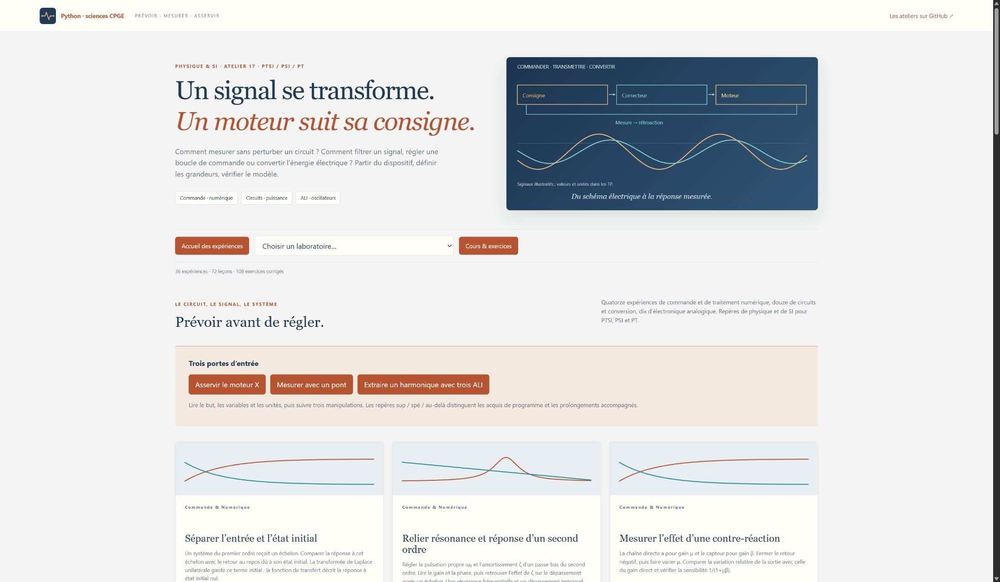

# Électricité & Technologies — PTSI / PSI / PT

Un atelier de physique et de sciences industrielles, construit à partir des fiches P15–P19 du recueil de A. R. La priorité va à **P17 : fonctions de transfert, rétroaction, moteur X, systèmes asservis et filtres numériques**. Chaque TP commence par son but, les grandeurs et unités, les hypothèses, puis trois manipulations guidées. Les repères **sup / spé / au-delà** précisent ce qui relève de la physique, de la SI ou d’un prolongement accompagné.

**36 laboratoires · 72 leçons · 108 exercices corrigés · 36 figures scientifiques.** Les réglages modifient les calculs Python ; les schémas de principe, signaux, spectres et réponses fréquentielles aident à interpréter les résultats.



| Parcours | Expériences |
|---|---|
| Commande & numérique — 14 TP | Passage temps–Laplace et conditions initiales ; second ordre ; rétroaction ; moteur X ; modèle électromécanique MCC ; correcteur PI ; stabilité et marges ; isolation sismique ; acquisition et repliement ; filtres RIF et RII ; discrétisation ; pôles et zéros ; modulation AM. |
| Circuits & conversion — 12 TP | Wheatstone ; ligne de transmission ; transitoires RLC ; impédances et résonance ; influence des instruments ; Graetz et double alternance ; doubleur ; diode et RC ; triphasé et transformateur ; onduleur et spectre ; hacheur et moteur ; puissances et compensation. |
| Électronique analogique — 10 TP | ALI réel ; suiveur et cascade ; sommateur ; intégrateur et dérivateur ; Schmitt ; astable ; Wien ; redressement de précision ; filtre à variables d’état à trois ALI ; transistor et polarisation. |

Les compléments privilégiés pour les filières technologiques portent sur **la mesure, les ALI réels, la chaîne d’acquisition numérique, la conversion de puissance et les performances d’un asservissement**. L’anti-saturation du PI, la transformée en z, les lignes réparties ou la polarisation détaillée d’un transistor sont accompagnées lorsqu’elles dépassent les attendus de la filière. La matrice [programme et recueil](MATRICE_PROGRAMME.md) distingue ces statuts.

[Lancer l’atelier](LISEZ_MOI.md) · [18 séances guidées](PARCOURS.md) · [Cours](COURS.md) · [Exercices corrigés](EXERCICES.md) · [Figures autonomes](illustrations/README.md) · [Errata des formules](errata.md)

Sous Windows, double-cliquer sur **Lancer_Electricite.cmd** à la racine du dépôt. Sous Linux ou macOS :

```bash
python -m pip install -r electricite_technologies/requirements.txt
python electricite_technologies/electricite.py
```

Adresse locale : **http://127.0.0.1:8783**. Python **3.10 ou plus récent**, NumPy ; Matplotlib est nécessaire seulement pour régénérer les illustrations. Après l’installation, l’atelier fonctionne hors ligne. Les résultats peuvent être téléchargés en JSON, avec les paramètres et les hypothèses. Le PDF personnel reste hors du dépôt.

Vérification : depuis ce dossier, `python -X utf8 -m unittest discover -v`. Les tests confrontent les modèles à leurs équilibres, lois de conduction, bilans, limites de stabilité et réponses analytiques ; ils vérifient aussi les contenus et le serveur local.
