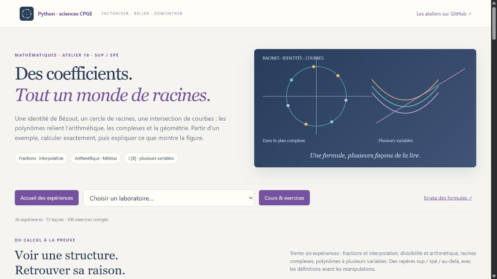

# Polynômes & Géométrie

Un neuvième volet de mathématiques pour **maths sup et maths spé**, construit à partir de la fiche **M17, pages 165–172**, de l’**exercice 5 des complexes, page 31**, et de l’**exercice 8 d’arithmétique, page 39** du recueil de A. R.

**36 laboratoires interactifs · 72 leçons · 108 exercices corrigés · 36 figures scientifiques.** Les polynômes à coefficients complexes et les polynômes à plusieurs variables disposent chacun de **dix laboratoires**. Chaque TP commence par son but, ses notations, ses hypothèses et trois premières manipulations.



| Parcours | Laboratoires |
|---|---|
| Fractions & Interpolation — 6 | Fraction du recueil avec pôle triple ; Taylor et parties polaires ; regroupement des pôles conjugués ; trous et pôles ; Runge et Lagrange ; Legendre, Tchebychev, Hermite et quadratures de Gauss. |
| Arithmétique & Divisibilité — 10 | Euclide et Bézout ; Gauss et Eisenstein ; inverse dans une algèbre quotient ; restes chinois ; Möbius ; comptage des irréductibles sur Fₚ ; Frobenius ; cyclotomie ; Bernoulli/Faulhaber ; Euler–Maclaurin. |
| Racines & Plan complexe — 10 | Transformation de Cayley et tangentes ; somme géométrique ; vrais coefficients complexes et borne de Cauchy ; Rouché ; Gauss–Lucas ; réciproque conjugué ; Viète/Newton ; bassins de Newton ; racines proches et perturbations ; récurrence du recueil prolongée à ℂ. |
| Plusieurs variables & Géométrie — 10 | Monômes et polygone de Newton ; intersections cercle–parabole et Bézout ; résultant avec candidat parasite ; Gröbner et ordre des monômes ; polynômes symétriques ; nœud/pointe/point isolé ; homogénéisation et point à l’infini ; forme quadratique en trois variables ; Motzkin ; optimisation d’un quartique sur un cercle. |

Les figures montrent des objets différents : cercles et enveloppes de racines, cartes de convergence, courbes algébriques, intersections avec multiplicité, coefficients et contributions arithmétiques. Les identités et certificats sont calculés **exactement** avec SymPy ; les coordonnées, interpolations et cartes sont **numériques**. Les indications **sup / spé / au-delà** relient le TP aux techniques utiles et introduisent les prolongements avant leur utilisation.

[Guide de lancement](LISEZ_MOI.md) · [18 séances guidées](PARCOURS.md) · [Cours](COURS.md) · [Exercices corrigés](EXERCICES.md) · [Recueil et repères](MATRICE_PROGRAMME.md) · [Figures SVG](illustrations/README.md) · [Errata des formules](errata.md)

Sous Windows, double-cliquer sur **Lancer_Polynomes.cmd**, à la racine du dépôt. Sous Linux ou macOS :

```bash
python -m pip install -r polynomes/requirements.txt
python polynomes/polynomes.py
```

Adresse locale : **http://127.0.0.1:8784**. **Python 3.10+**, NumPy et SymPy. Après l’installation, les laboratoires fonctionnent hors ligne. Matplotlib est nécessaire uniquement pour régénérer les figures déjà livrées. Les paramètres, résultats, tableaux, figures et hypothèses peuvent être exportés en JSON.

Vérification : depuis ce dossier, `python -X utf8 -m unittest discover -v`. Les contrôles portent notamment sur les identités exactes, les pôles multiples, les quadratures, les comptages indépendants sur les corps finis, les racines complexes et les cas dégénérés des modèles multivariés.

Le PDF personnel reste hors du dépôt. L’errata demandé se limite à des erreurs de formules vérifiées dans leur contexte.
