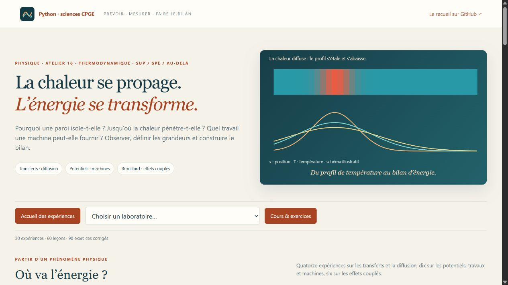

# Chaleur & Transferts · Atelier 16 · Thermodynamique

**30 laboratoires interactifs, 60 leçons, 90 exercices corrigés et 30 figures scientifiques.**
À partir des fiches **P22–P24, pages 450–470**, du recueil de A. R. : observer un phénomène, définir les grandeurs puis établir les bilans.



## La priorité : P23, transferts et diffusion

**14 laboratoires** développent les transferts : barre conductrice, paroi composée, isolation cylindrique ou sphérique, igloo, diffusion transitoire à une et deux dimensions, milieu semi-infini, ondes thermiques, refroidissement et nombre de Biot. La marche au hasard, Langevin et Stokes–Einstein, la diffusion d’un électrolyte, l’absorption de neutrons et la production d’entropie relient transport, probabilités et thermodynamique.

Les cartes, profils et courbes calculés permettent de vérifier la conservation, la stabilité d’une méthode numérique et l’échelle de diffusion : une durée multipliée par quatre correspond à une distance caractéristique multipliée par deux. Les solutions analytiques servent de référence ; leurs hypothèses sont précisées.

## Potentiels, travaux et machines

**10 laboratoires** relient énergie libre de Helmholtz, enthalpie libre de Gibbs et équilibre. Un piston, une cloison élastique, une réaction idéale et un calorimètre donnent un sens concret aux variations d’énergie et d’entropie. Travaux de pression, de surface, élastiques, électriques et magnétiques sont comparés avec leurs unités et leurs conditions d’application.

Machines dithermes, Carnot, cycles de moteurs, compression à plusieurs étages, détentes de Joule et travail maximal d’un corps fini : les rendements sont accompagnés des bilans de chaleur, de travail et d’entropie. Un résultat dépend toujours du système et des contraintes choisis.

## Effets couplés et brouillard

**6 laboratoires** prolongent P24 : cube de Leslie et rayonnement, thermocouple Seebeck, réfrigération Peltier, thermoacoustique, résonateur piézoélectrique et formation du brouillard.

L’exercice 1 des **pages 469–470** est développé par une comparaison entre la pression de vapeur et la pression de saturation pendant une détente. Le critère indique le **début de condensation** ; la loi adiabatique du gaz seul n’est plus utilisée pour décrire le mélange après ce début.

## Aborder une expérience

Chaque TP commence par son but, les **variables et unités**, puis les hypothèses. Les repères **sup / spé / au-delà** indiquent les techniques à réinvestir selon la filière. Trois manipulations conduisent à une question précise à justifier. Les leçons et corrigés restent accessibles sans lancer Python.

Les scènes et graphiques sont calculés en Python. Les schémas de principe identifient les dispositifs ; leurs dimensions ne sont pas à l’échelle. Survoler un graphique ou utiliser son curseur pour examiner les données. Les résultats se téléchargent au format JSON.

**Convention :** chaleur Q et travail W positifs s’ils sont reçus par le système. Les formules thermodynamiques utilisent la température absolue, en kelvins ; les tracés en degrés Celsius sont signalés. Une puissance s’exprime en watts, une énergie en joules.

## Lancer l’atelier

**Python 3.10+ et NumPy.** Sous Windows, double-cliquer sur **`Lancer_Thermodynamique.cmd`**, à la racine du dépôt ou dans ce dossier. Internet est nécessaire lors de la première installation de NumPy ; l’atelier fonctionne ensuite hors ligne.

Sous Linux ou macOS, dans ce dossier :

```bash
python3 -m venv .venv
source .venv/bin/activate
python -m pip install -r requirements.txt
python thermodynamique.py
```

Ouvrir **http://127.0.0.1:8782**. Matplotlib sert uniquement à régénérer les figures : `python -m pip install -r requirements-illustrations.txt`, puis `python thermodynamique.py --export-illustrations`.

[Guide de lancement](LISEZ_MOI.md) · [Quinze séances](PARCOURS.md) · [60 leçons](COURS.md) · [90 exercices corrigés](EXERCICES.md) · [Figures SVG](illustrations/README.md) · [Corrections de formules](ERRATA.md) · [Repères du programme](MATRICE_PROGRAMME.md).

## Vérifications et sources

Les vérifications portent sur les conservations, les identités thermodynamiques, les limites réversibles, les signes, les solutions de référence et les scénarios des commandes. Le serveur local et les liens entre expériences, leçons et exercices sont également contrôlés.

```bash
python -X utf8 -m unittest discover -v
```

Source principale : **P22–P24, pages imprimées 450–470**, recueil de A. R. Le PDF personnel n’est pas redistribué. L’errata se limite à des erreurs de formules vérifiées dans leur contexte.

Repères de formation : [programme officiel MP](https://prepas.org/ups.php?document=87) et [programme officiel PC](https://prepas.org/ups.php?document=92). Les développements dépassant les attendus communs sont explicitement accompagnés.
